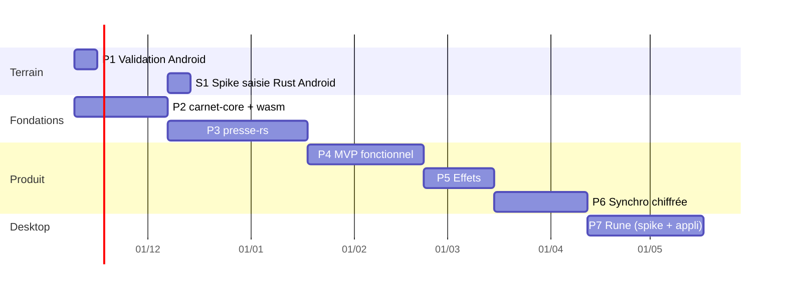

# Carnet — roadmap technique

> Statut : proposition à relire (revue Codex demandée). Rédigée le 7 novembre 2026.
> Branche : `carnet/v0`. Code existant : `carnet.html`, `carnet-banc.html`, `src/carnet/`, `src/presse/lib.ts`.
> Brief produit (positionnement, esthétique, features) : document « Carnet — brief produit », hors dépôt.

## 0. En une phrase

Carnet est un bullet journal à l'esthétique papier, Web + Android d'abord, écrit **en Rust à environ 90 %** :
le modèle et la logique dans `carnet-core`, le rendu GPU dans `presse-rs` (portage de Presse sur wgpu), les effets en
WGSL partagés ; seule la saisie de texte reste au DOM sur web et Android, parce que c'est la seule façon aujourd'hui
d'avoir le clavier natif (accents, dictée, correction) sans réécrire un éditeur de texte mobile.

## 1. Décisions prises

| # | Décision | Raison | Écarté |
|---|---|---|---|
| D1 | Cibles : **Web + Android** d'abord ; desktop ensuite ; iOS plus tard | Priorité produit | — |
| D2 | Android = **PWA installée** depuis Chrome, puis **TWA** (Bubblewrap) pour le Play Store | Pas de couche native à maintenir | Capacitor (choix produit : non) |
| D3 | **Rust ≈ 90 %** : `carnet-core` (logique, données), `presse-rs` (rendu), WGSL partagé | Un seul moteur de rendu pour web, Android et desktop | Tout-Rust strict : la saisie mobile dans une UI dessinée par le GPU (IME Android, textarea caché sur le web) n'est résolue par personne aujourd'hui |
| D4 | **Saisie au DOM** sur web/Android (champs `input` / `contenteditable`), relus et repeints par le moteur | Clavier natif garanti, accessibilité et sélection du navigateur | Champ de texte maison en GPU |
| D5 | Données en **CRDT yrs** (port Rust de Yjs), compilé en wasm | Local-first, synchro sans serveur qui lit, format Yjs interopérable | Journal d'opérations LWW maison ; y-octo (encore v0.1, sous-documents en cours) |
| D6 | **Desktop : Rune** (wgpu), qui accueille `presse-rs` par son hook `Compositor` | Rendu GPU, texte et ressorts maison, accès wgpu complet | GPUI + GPUI Kit (pas d'effets intégrés) ; NSH (shaders limités à un `shade(uv)` sans textures) |
| D7 | Effets en **WGSL**, contrat déterministe `(temps, graine, paramètres)` | Écrits une fois, joués par Presse TS, `presse-rs` et Rune | Three.js + TSL (second moteur à côté de Presse) |
| D8 | Rendu **à la demande** : aucune image quand rien ne bouge | Application ouverte toute la journée sur un téléphone | Boucle permanente |
| D9 | Pas de React pour l'instant : réconciliation par clé faite main (`src/carnet/view.ts`) | Presse rejoue l'apparition à l'encre de tout élément neuf : il faut contrôler l'identité des éléments | À réévaluer en P4 si la vue grossit |

## 2. État actuel (P0, fait)

| Élément | Où | Vérifié |
|---|---|---|
| Semaine en double page, vue jour, saisie par signifiants, cycle d'état, rature | `src/carnet/view.ts`, `main.ts` | Playwright, SwiftShader |
| Migration : morphing des lettres d'un jour à l'autre | `data-gl-morph-id` / `data-gl-morph-from`, `src/gpu/text.ts` | Vidéo à horloge virtuelle |
| Suggestions au crayon (veille, agenda d'exemple), crayon → encre | `src/carnet/model.ts` | Playwright |
| Vol semaine ↔ jour (lignes + contour + titre) | `src/carnet/flight.ts` | Vidéo à horloge virtuelle |
| Mode à la demande du moteur, `data-gl-ignore` | `src/gpu/engine.ts`, `governor.ts`, `src/presse/index.ts` | **0 image demandée en 3 s de repos** |
| API publique de Presse | `src/presse/lib.ts` | Typage |
| Banc de mesure Android | `carnet-banc.html`, `src/carnet/banc.ts` | **Non** : en rendu logiciel le compositeur tombe à quelques images/s ; chiffres réels attendus d'un appareil |
| Données | `localStorage` (`carnet.v0`) | — |

Prototype HTML de design (autocollants, mois, semaine) : hors dépôt, sert de référence visuelle.

## 3. Architecture cible

```text
                ┌──────────────────────── web / Android (PWA, TWA) ────────────────────────┐
                │  DOM : vues, champs de saisie, accessibilité        TS mince (≈ 500 lignes) │
                │        │ commandes / modèles de vue                     │ boîtes, glyphes   │
                │  carnet-wasm ── carnet-core ──┐                 presse-rs (wasm, WebGPU)  │
                └───────────────────────────────┼──────────────────────────┼───────────────┘
                                                │                          │
   shaders/ (WGSL, contrat temps+graine) ───────┼──────────────────────────┤
                                                │                          │
                ┌───────────────────────────────┼──────── desktop ─────────┼───────────────┐
                │  carnet-desktop (Rune) ── carnet-core            presse-rs (natif, wgpu) │
                │  saisie, mise en page : Rune              hôte : Rune Compositor         │
                └──────────────────────────────────────────────────────────────────────────┘
                                   relais de synchro : mises à jour yrs chiffrées (P6)
```

### 3.1 Dépôt

P1 à P3 dans ce dépôt, workspace Cargo sous `crates/` (Presse TS y vit déjà et sert de référence de parité).
Extraction en deux dépôts (`presse`, `carnet`) à la fin de P3, quand `presse-rs` tient seul. *Question Q1.*

```text
crates/
  carnet-core/      logique pure, sans E/S
  carnet-wasm/      frontière wasm-bindgen, persistance navigateur
  presse-rs/        moteur de rendu (wgpu), sans dépendance au DOM
  presse-web/       hôte web de presse-rs (web-sys) : lecture des boîtes et glyphes, boucle d'images
  carnet-desktop/   application Rune (P7)
  spike-textfield/  spike S1 (jetable)
shaders/            WGSL partagé + manifeste des effets
src/carnet/         coquille web (TS) : vues DOM, saisie, service worker
```

### 3.2 `carnet-core`

**Modèle de documents yrs.** Un document par page, pour charger et synchroniser par morceaux :

| Document | Clé | Contenu |
|---|---|---|
| Index | `root` | liste des pages, réglages, suggestions écartées (`dedupeKey`), collections |
| Semaine | `w:<lundi AAAA-MM-JJ>` | entrées des 7 jours, notes de semaine, blocs, autocollants, traits |
| Mois | `m:<AAAA-MM>` | page libre du mois (entrées datées ou non), couverture, autocollants |
| Collection | `c:<ulid>` | blocs libres |

- Les entrées sont dans une `Y.Map` indexée par ULID, **pas dans un `Y.Array`** : l'ordre se calcule (heure, puis
  `createdAt`), ce qui évite les conflits d'insertions concurrentes.
- Champs d'une entrée : `kind`, `state`, `marks`, `text`, `time`, `day` | `date`, `createdAt`, `migratedTo`, `origin`,
  `sticker`. Suppression douce (`deletedAt`).
- Traits : `Y.Array` de blobs par bloc (points quantifiés en dixièmes de case, delta-encodés, pression sur 8 bits).
- Autocollants : `Y.Map` par ULID, **ancrés à un bloc** (`anchor`, `dx`, `dy` locaux, `rot`, `size`, `sym`, `season`).
- **Migration entre deux semaines** = deux documents. Pas d'atomicité entre documents : on écrit d'abord la copie
  (ULID dérivé de l'original, donc idempotente), puis `migratedTo` sur l'original. Un état intermédiaire montre au
  pire la tâche deux fois, jamais zéro. *Question Q3.*

**API.** Commandes (`add_entry`, `edit_text`, `cycle_state`, `migrate`, `keep_suggestion`, `dismiss`,
`place_sticker`, `move_sticker`, `add_stroke`…), requêtes qui rendent des **modèles de vue** (`week_view(lundi)`,
`day_view(jour)`, `month_view(mois)`), événements (pages changées). Aucune E/S : traits `Storage`, `Clock`,
`PhotoSource`, `WeatherSource`, `CalendarSource` fournis par l'hôte.

**Suggestions.** Moteur dans le core : sources branchables, normalisation, dédoublonnage (`dedupeKey`), score,
5 par jour au plus (3 par jour en vue semaine). Sources P2 : veille, prévu ce mois, il y a un an. P4 : photos EXIF,
météo (Open-Meteo, coordonnées arrondies à ≈ 100 m), ICS.

**EXIF.** `kamadak-exif` (pur Rust). Regroupement des photos par heure (écart < 90 min), puis par lieu si le GPS est
présent.

**Tests.** Unitaires ; **proptest** de convergence (deux répliques, mêmes commandes dans un ordre aléatoire avec
échanges de mises à jour partiels → mêmes modèles de vue) ; idempotence de la migration ; import des données v0.

### 3.3 `carnet-wasm` (frontière)

- `wasm-bindgen` ; modèles de vue par `serde-wasm-bindgen` ; commandes en appels courts.
- Persistance : chaque mise à jour yrs est ajoutée à un journal IndexedDB par document ; compaction (fusion des
  mises à jour) au-delà de N entrées ou à la fermeture. Photos et miniatures dans OPFS.
- Import unique des données `localStorage` de la v0.
- Budget : taille du wasm à mesurer dès la semaine 1 de P2 (cible ≤ 400 Ko gzip pour le core seul). *Question Q4.*

### 3.4 `presse-rs`

**Périmètre : ce que Carnet utilise de Presse, rien d'autre.**

| Porté | Pas porté |
|---|---|
| Boucle à la demande, gouverneur de cadence | Plans d'images à matières (lentille, flammes, fluide…) sauf les tirages photo |
| Atlas SDF (texte courant, précalculé) et MTSDF (titres) | Effets Canvas UI (vhs, glitch, tissu…) |
| Instances de glyphes, apparition à l'encre, morphing intra- et inter-éléments | Galerie, grille, liquide, orbite, objet |
| Papier, grain, composition | Transitions d'impression, balayage ASCII |
| Perte d'appareil GPU et reprise | Capture vidéo (reste dans Presse TS) |

- **Trait d'hôte** :
  ```rust
  trait Host {
      fn scene(&mut self) -> Scene;          // boîtes d'éléments, runs de glyphes (position, couleur, police), ids de morphing
      fn element_boxes(&mut self, out: &mut [Rect]); // relu à chaque image : seules les boîtes bougent
      fn request_frame(&mut self);
      fn now(&self) -> f64;
  }
  ```
  `presse-web` l'implémente sur le DOM, Rune (P7) sur sa propre mise en page.
- **Mesure des glyphes sur le web.** Aujourd'hui un `Range` par caractère, en TS. Première version : on garde cette
  mesure en TS et on passe un `Float32Array` à `presse-rs` (zéro copie). La passer en `web-sys` n'a d'intérêt que si
  le profil le montre. *Question Q5.*
- **WGSL.** Les gabarits de `src/gpu/wgsl.ts` utilisent des interpolations `${…}` : on les convertit en fichiers
  `.wgsl` avec constantes `override` ou `const`, validés par naga au build (`build.rs`).
- **Parité.** `tools/visual` (pixelmatch, SwiftShader, horloge factice, `Math.random` à graine) compare Presse TS et
  `presse-rs` sur les pages de Carnet. Seuil : ≤ 0,5 % de pixels différents, aucune région > 16 × 16 px.

### 3.5 `shaders/` : contrat des effets

```wgsl
struct Fx {
  time: f32,        // secondes depuis le début de l'effet (horloge virtuelle en capture)
  seed: f32,        // graine stockée avec l'objet : même rendu sur tous les appareils
  progress: f32,    // 0 → 1 pour un effet ponctuel ; 1 = état final (mouvement réduit)
  intensity: f32,
  params: array<vec4f, 4>,
}
```

- Effets de surface : fonction `fn shade(uv: vec2f, fx: Fx) -> vec4f` (compatible avec le contrat `shade(uv)` de
  NSH et les fills de `rune-fx`).
- Effets à état (diffusion d'encre, aquarelle) : passes compute avec textures ping-pong, état final précalculable.
- Manifeste `shaders/effects.toml` : nom, type (`surface` | `compute`), schéma des paramètres, coût mesuré par le banc.
- On ne stocke jamais de pixels : paramètres + graine, rendu mis en cache localement.

### 3.6 Coquille web / Android

- TS mince : vues DOM (réconciliation par clé), champs de saisie, routage hash, service worker (hors ligne),
  manifeste PWA. Appelle `carnet-wasm` et `presse-rs`.
- Sans WebGPU : la page reste son HTML, l'application fonctionne sans effets.
- TWA (Bubblewrap) en fin de P4 si la publication sur le Play Store est voulue.

### 3.7 Synchro (P6)

Relais minimal (Rust, axum) qui stocke des **mises à jour yrs chiffrées** par document ; clé dérivée d'une phrase
secrète (Argon2id), AES-GCM par mise à jour ; le relais ne voit que des identifiants de documents opaques et des tailles.

## 4. Phases

Estimations pour un développeur assisté d'agents, en semaines de travail. Les portes (critères de sortie) sont
mesurables ; on ne passe pas une porte « presque ».



Total : ≈ 27 semaines jusqu'au desktop ; ≈ 15 semaines jusqu'au MVP Web + Android en Rust (P2 + P3 + P4).
P1 et S1 sont dessinés en parallèle mais prennent le même développeur : compter une semaine de plus chacun.

### P1 — Validation terrain Android (1 semaine, en parallèle de P2)

But : remplacer les hypothèses par des mesures sur un vrai téléphone avant d'investir.

- [ ] Manifeste PWA + service worker minimal : Carnet v0 installable depuis Chrome Android
- [ ] Banc (`carnet-banc.html`) sur un Android milieu de gamme : 5 tests sur secteur, batterie sur 2 min
- [ ] Photos : la date EXIF et le **GPS** survivent-ils au sélecteur de fichiers dans la PWA installée ?
- [ ] Recette de saisie (reprise de la recette web de Rune) : accents, composition, remplacement prédictif,
      correction automatique, dictée, Entrée sur mobile, collage, sélection, dans les champs DOM sous le canvas
- [ ] WebGPU disponible ? Mode compatibilité nécessaire ?

**Sortie** : `docs/carnet/terrain-android.json` (résultats du banc) + verdicts. Budget d'effets fixé (temps GPU par
image disponible pour P5). Décision sur le regroupement des photos (heure seule ou heure + lieu).

### P2 — `carnet-core` + `carnet-wasm` (4 semaines)

- [ ] Workspace Cargo, CI (fmt, clippy, tests, `wasm-pack test --headless`)
- [ ] Modèle yrs (§ 3.2), commandes, modèles de vue semaine / jour / mois
- [ ] Suggestions : veille, prévu ce mois, il y a un an
- [ ] Persistance IndexedDB (journal + compaction), import `localStorage` v0
- [ ] Frontière wasm ; la coquille TS de la v0 passe sur `carnet-wasm` (plus aucune logique métier en TS)
- [ ] Tests : unitaires, proptest de convergence, idempotence de migration
- [ ] Taille du wasm et temps de démarrage mesurés

**Sortie** : v0 identique à l'œil, mais toute la logique en Rust ; 2 répliques convergent sous proptest
(≥ 10 000 cas) ; démarrage à froid ≤ 300 ms sur l'Android de P1 ; **14 jours d'usage réel** par Jérôme (porte du
brief : le rituel tient).

### S1 — Spike « champ de texte Rust sur Android » (1 semaine, jetable)

But : savoir si le tout-Rust strict devient atteignable, sans le payer maintenant.

- [ ] winit + `android-activity` + wgpu + parley : un champ de texte multiligne dessiné par le GPU
- [ ] Recette de P1 rejouée dans ce champ

**Sortie** : tableau réussi / échoué par point de la recette. Tout vert → la question du 100 % Rust revient en
fin de P4. Un seul rouge sur accents, dictée ou correction → on n'y revient pas avant que Rune ou winit le règlent.

### P3 — `presse-rs` (6 semaines)

- [ ] Semaine 1 : squelette wgpu sur wasm (WebGPU), triangle + papier ; **taille du wasm et temps d'init mesurés**
      (porte intermédiaire : si l'ensemble dépasse 1,5 Mo gzip ou 500 ms d'init sur l'Android de P1, on revoit le
      périmètre avant d'aller plus loin)
- [ ] Trait `Host`, `presse-web`, boucle à la demande, gouverneur
- [ ] Conversion des gabarits WGSL utilisés (§ 3.4) en `.wgsl` validés par naga
- [ ] Atlas SDF/MTSDF (fichiers précalculés de `tools/bake.mjs`, `tools/msdf.py`), instances de glyphes, apparition
- [ ] Morphing intra-élément et inter-éléments, y compris la survie à une nouvelle mise en page
- [ ] Perte d'appareil et reprise
- [ ] Banc rejoué sur `presse-rs`

**Sortie** : parité visuelle (§ 3.4) sur semaine, jour, migration, vol ; temps par image ≤ Presse TS sur l'Android
de P1 ; 0 image au repos ; Carnet tourne sur `presse-rs`, Presse TS n'est plus chargé par Carnet.

### P4 — MVP fonctionnel (5 semaines)

- [ ] Mois en double page : calendrier + page libre ; entrées datées qui remontent au crayon ; migration mensuelle
- [ ] Vue jour complète ; index ; collections (blocs libres)
- [ ] Canevas + blocs ancrés : traits à la pression (Pointer Events), autocollants ancrés aux blocs (fin du
      problème de placement sur mobile du prototype)
- [ ] Planches d'autocollants (saisons, activités, rendez-vous) ; mini-autocollant deviné sur les événements
- [ ] Suggestions photos EXIF (selon P1), météo, ICS
- [ ] Tracker dessiné, colorié selon les données (sans aquarelle : elle arrive en P5)
- [ ] Export Markdown + JSON ; hors ligne complet ; TWA si voulu

**Sortie** : **30 jours d'usage réel** sur Android ; aucune perte de données (journal IndexedDB vérifié à chaque
démarrage) ; tâches courantes faisables au clavier et au lecteur d'écran sur le web.

### P5 — Effets (3 semaines)

- [ ] `shaders/` + manifeste + contrat `Fx` ; hôte d'effets dans `presse-rs`
- [ ] P0 : l'encre boit le papier (compute), crayon → encre, papier éclairé selon l'heure
- [ ] P1, dans le budget de P1 : autocollants holographiques (orientation de l'appareil), aquarelle du tracker,
      photos qui se développent, ambiance de saison (2–3 s), miettes de gomme
- [ ] Mouvement réduit : états finaux directs ; économie d'énergie : effets à état précalculés

**Sortie** : chaque effet passe le banc (« Tenu ») sur l'Android de P1 ; aucun effet ne garde le moteur éveillé
après sa fin.

### P6 — Synchro chiffrée (4 semaines)

**Pré-requis** : modèle économique tranché (décision ouverte n° 5 du brief).

- [ ] Relais (axum) : stockage des mises à jour par document, aucune donnée en clair
- [ ] Clés : phrase secrète → Argon2id → clé de chiffrement ; récupération documentée
- [ ] Synchro différentielle par vecteur d'état yrs ; reprise après coupure
- [ ] Tests : 3 répliques, réseau coupé et rétabli dans le désordre

**Sortie** : deux appareils (Android + web) convergent après 48 h de modifications hors ligne de part et d'autre.

### P7 — Desktop Rune (4 semaines, après un spike d'une semaine)

- [ ] Spike : semaine en double page dans Rune, sur `carnet-core` ; `presse-rs` dans le `Compositor`
- [ ] Application : semaine, jour, mois, saisie Rune, synchro P6
- [ ] Révision de Rune figée ; anomalies remontées par issues (le projet n'accepte pas de PR)

**Sortie** : même carnet sur desktop et Android, synchronisé ; effets identiques à l'image près (mêmes WGSL,
mêmes graines).

### Plus tard — décision 100 % Rust, iOS

Revue au début de P7 : résultat de S1, état de Rune sur Android (saisie vérifiée sur appareil ?), état de winit.
iOS : NSH (UIKit) ou Rune selon qui livre d'abord une saisie fiable et des composants hôtes.

## 5. Risques

| Risque | Probabilité | Impact | Signal précoce | Parade |
|---|---|---|---|---|
| Taille et démarrage du wasm (yrs + wgpu) sur Android | Moyenne | Fort | Mesures semaine 1 de P2 et P3 | Chargement différé de `presse-rs` (page lisible sans lui), découpage, `wasm-opt -Oz` |
| Mesure des glyphes par `Range` trop chère sur une longue semaine | Moyenne | Moyen | Profil P3 | Cache par élément (déjà : seules les boîtes sont relues par image), mesure incrémentale |
| WebGPU absent ou en mode compatibilité sur l'Android cible | Faible à moyenne | Moyen | P1 | La page reste son HTML ; effets coupés proprement |
| GPS retiré des photos dans la PWA | Moyenne | Faible | P1 | Regroupement par heure seule |
| Migration entre documents interrompue | Faible | Faible | Tests P2 | Copie d'abord, ULID dérivé, idempotence |
| Rune : API instable, pas de PR | Forte | Moyen (desktop seulement) | Changelog | Révision figée ; desktop hors chemin critique |
| Deux interfaces (TS mince + Rune) à maintenir | Certaine | Moyen | — | Toute la logique dans `carnet-core`, vues réduites à de l'affichage |
| Batterie (effets, rendu) | Moyenne | Fort | Banc P1, P5 | Rendu à la demande, budget par effet, états finaux précalculés |
| Débit d'un seul développeur | Certaine | Fort | Retard de porte | Portes strictes ; P6 et P7 déplaçables sans toucher au MVP |

## 6. Questions pour la revue

1. **Q1 — Dépôt.** Workspace dans ce dépôt jusqu'à P3, puis extraction : ou dépôts séparés tout de suite ?
2. **Q2 — Ordre P3 / P4.** Porter le rendu (P3) avant le MVP (P4) retarde la valeur produit de 6 semaines mais évite
   d'écrire deux fois l'intégration des features avec le moteur. Faut-il inverser, ou entrelacer ?
3. **Q3 — Granularité yrs.** Un document par semaine et par mois : bon compromis entre taille de synchro et
   opérations multi-documents (migration) ? Faut-il des sous-documents yrs dans un document racine ?
4. **Q4 — Frontière wasm.** `serde-wasm-bindgen` pour les modèles de vue suffit-il, ou faut-il des tampons typés
   (comme pour les glyphes) dès P2 ?
5. **Q5 — Mesure des glyphes.** Garder la mesure DOM en TS et passer un `Float32Array`, ou tout faire en `web-sys` ?
6. **Q6 — WGSL.** Conversion des gabarits interpolés en `.wgsl` + `override` : y a-t-il des cas où le
   remplacement à la construction (préprocesseur) reste nécessaire ?
7. **Q7 — Effets à état.** Où vit l'état des effets compute (diffusion d'encre) quand le moteur s'endort : rendu
   final mis en cache dans une texture par bloc, ou recalcul à la demande à partir de la graine ?
8. **Q8 — Accessibilité.** Le texte repeint par le GPU reste en DOM transparent : suffisant pour les lecteurs
   d'écran sur Android (TalkBack) ? Que faut-il tester en P4 ?
9. **Q9 — Estimations.** Les durées de P2 (4 sem.) et P3 (6 sem.) sont-elles crédibles au regard du code existant
   (`src/gpu/engine.ts` 1 755 lignes, `src/gpu/text.ts` 456, `src/gpu/wgsl.ts` 2 629, dont seule une partie est
   portée) ?
10. **Q10 — Angles morts.** Qu'est-ce qui manque à cette roadmap pour qu'un MVP Android tienne 30 jours sans perte
    de données ?

## 7. Hors champ

iOS, collaboration à plusieurs sur un même carnet, IA générative, import depuis d'autres applications de journal,
version payante (dépend de la décision n° 5 du brief), Rune sur Android (dépend du projet Rune).
